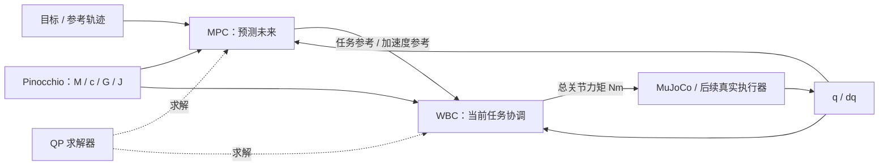

# 从关节力矩到最优控制：分阶段实践路线

目标是能自己建立模型、写出优化变量/目标/约束、选择求解方法，并用实验解释结果。
每一阶段先在本地仿真完成推导、实现和验收，再选择适合的部分迁移左臂。
不要等所有算法学完才接真机，也不要让尚未验证的控制器直接接管真机。

## 四个概念的位置

| 概念 | 解决的问题 | 本项目中的输入与输出 |
| --- | --- | --- |
| LQR | 在线性模型和二次代价下设计最优反馈增益 | 离线求 K；在线 `u=-Kx`，加平衡力矩后输出 Nm |
| MPC | 在有限预测时域内优化动作，并不断重算 | 状态/参考/约束 → 未来控制序列，只执行第一步 |
| WBC | 协调当前关节、末端、姿态、接触等任务 | 当前状态/任务 → 当前加速度、关节力矩、可选接触力 |
| QP | 二次目标、线性等式/不等式组成的优化问题 | `P,c,A,l,u` → 最优变量、状态、残差、耗时 |

QP 是数学问题类型；线性 MPC、许多 WBC 可以形成 QP。
LQR 通常用 Riccati 方程离线求解，不需要每个周期都调用 QP。
WBC 是控制组织方法，不强制使用某一种求解器，也不等同于“力矩控制”的另一种名字。



MPC 也可以直接输出力矩，不必总接 WBC；第一轮单轴 MPC 就采用这条直接通路。
LQR 先作为独立基线，再用于 MPC 终端代价和经过验证的后备控制器。

## 通用数学与工程约定

固定基座自由空间模型：

\[
M_{eff}(q)\ddot q+c(q,\dot q)+G(q)+\tau_f(\dot q)=\tau.
\]

G 是抵消重力所需的广义力矩，`h=c+G`。Pinocchio 的 `nonLinearEffects` 返回 h，不是单独的 c。
`M_eff` 包含第 7 轴 armature；物理摩擦与软件阻尼分开记录。

- `q,dq,ddq`：rad、rad/s、rad/s²；`tau`：输出侧 Nm；长度 m，质量 kg。
- 左臂顺序固定 `left_joint1` 到 `left_joint7`，通过名字核对索引。
- 末端六维雅可比顺序 `[linear; angular]`，在末端原点、用 world 轴表达。
  Pinocchio 对应 `LOCAL_WORLD_ALIGNED`，不能不加区分地换成 `WORLD`。
- 控制器返回总力矩，运行器不自动加 G。输出已经包含逆动力学时不要重复补偿。
- 默认 1 ms 物理步长；优化器可每 10/20 个物理步更新，期间保持或插值上次输出。
  优化模型的采样周期、控制更新周期和约束中 dt 必须一致。
- 参数分成真实已知值、估计值和算法增益。优化权重不属于物理辨识参数。

## 阶段 00：已有基础与电脑端复核

**状态：2026-11-06 本机数值复核及桌面 viewer 运行通过；真实轴方向仍需人工核对。**

按 README 安装环境，跑基础测试、`validate --pinocchio`、重力基线和窗口。
观察关节名称、轴方向和末端坐标系，保存本机模型哈希、依赖版本、验证报告。
重力基线从精确静止开始不下落，只证明相同模型下的平衡正确，不能证明 CAD 参数真实。
当前没有碰撞、接触、实际被动摩擦，执行器默认瞬时理想响应。

## 阶段 01：二维 QP，把优化问题写清楚

**状态：2026-11-06 已完成；纯数值离线实验，不需要模型运动。**

运行入口：`python -m kaixuan_control_lab.run_qp2d`。
推导和使用见 [阶段 01 说明](experiments/01_qp/README.md)，
本机数值结果见 [验收记录](experiments/01_qp/VALIDATION.md)。

优化变量 `z∈R²`，采用：

\[
\min_z \tfrac12(z-r)^T H(z-r),\quad
H=\operatorname{diag}(2,1),\quad
-1\le z_1,z_2\le1,\quad z_1+z_2\le0.8.
\]

令 r 从可行域内部走向外部，比较无约束解、受约束解、活跃约束。
转成 OSQP 格式 `P=H, c=-Hr, l≤Az≤u`，省略与 z 无关的常数项。
用二维网格/等高线直观查看代价，用枚举活跃集得到独立参考解。

需要解释梯度、Hessian、凸性、拉格朗日乘子与 KKT：

```text
stationarity: H(z-r) + Cᵀλ = 0
primal feasibility: Cz <= d
dual feasibility: λ >= 0
complementarity: λᵢ(Cz-d)ᵢ = 0
```

产出建议：`experiments/01_qp/` 下的脚本、二维图、结果 CSV、简短推导。
验收：OSQP 与独立参考解误差 <1e-6；计算并记录可行性/驻点/互补残差；
人为制造不可行约束，正确处理求解状态，不能把失败时的 x 当作有效动作。
先学清楚 ADMM 的迭代与残差含义，再比较活跃集、内点法、近端方法。

## 阶段 02：七轴末端直线跟踪与外力扰动

**状态：按用户要求替换原第七轴回零实验。**

入口：`python -m kaixuan_control_lab.run_lqr --pinocchio`。
详细推导、对照与复现见 [阶段 02](experiments/02_lqr/README.md)，
结果见 [验收记录](experiments/02_lqr/VALIDATION.md)。

七轴全部可动，默认演示中末端保持姿态走约 30 cm 直线；在运动中的 3.00–4.50 秒
施加峰值 5 N 的世界系侧向外力。小扰动基准仍可显式选择 `config/cartesian_lqr.yaml`。
使用连续逆运动学和关节样条生成 q/dq/ddq，以逆动力学计算总前馈力矩。
对整条参考的完整七轴动力学线性化、ZOH，求有限时域时变 LQR，
终端采用静止模型 DARE 解，在线 `tau=tau_ref-K(t)*[e_q;e_dq]`。

对照参考前馈加独立 PD、计算力矩加 PD，统一参考、物理模型、推力和限值。
扫描 PD 频率，并将较快的计算力矩 PD 加入主图与延迟测试。
包含无扰动、正/反向推力、物理执行器延迟/一阶响应、较大推力保护实验。
记录末端 RMS/峰值/恢复时间、姿态误差、总电机力矩、饱和、速度、计算耗时、模型/源码哈希。
不预设 LQR 优于调好的 PD；保护停机的部分代价不能参与完整代价排名。
默认演示只要求声明的 LQR 常规运行完成，其余对照保留保护停机；小扰动基准仍要求三种方法完成。
视频用中文提示施力阶段，配同步曲线、等比例路径投影和 0.5 倍速，避免全景看不清短时偏差。

未改动模型的惯量假设，没有附加工具；无真实碰撞/接触。
原单轴 LQR 的配置、实现、测试、说明和生成结果已删除。

## 阶段 03：单轴线性 MPC，显式处理限制

这是未来阶段，尚未实现。可另建一个明确的单轴受限问题，先自行建立 Ad/Bd/Q/R，
不要把阶段 02 的七轴时变矩阵直接当作常数单轴模型。
建议起步采样周期 10 ms、N=50，预测时域 0.5 s。
物理仿真保持 1 ms；这只是学习初值，实际实时预算要在运行电脑/机器人上测量。

\[
\min \sum_{k=0}^{N-1}(x_k^TQx_k+u_k^TRu_k)+x_N^TPx_N
\]

约束包括初始状态、离散动力学、位置、速度、力矩，以及相邻力矩变化量。
先使用稀疏形式的变量 `[x1,...,xN,u0,...,uN-1]`，写出每个矩阵块的尺寸。
力矩约束是 `-tau_max <= tau0+u_k <= tau_max`，不能只约束 u。
第一步斜率约束要引用真正的上一条控制指令；有执行器滤波时还要区分指令和实际力矩。

P 先用 LQR 的 Riccati 解。无约束、模型相同且终端代价匹配时，第一步控制应与 LQR 一致。
有约束时，仅添加这个 P 并不能自动保证所有初始状态下的稳定性；后续再学习终端集合等条件。

验收：无约束对照误差 <1e-5；有约束时记录最大违反量；展示 MPC 如何提前减速，
比较“直接裁剪 LQR”与“规划中处理限制”。
加入 warm start、不可行状态、迭代上限、求解超时实验，日志包含原始/对偶残差、迭代数和求解耗时。
后备控制器只能在其已验证区域内使用；若状态超出可恢复范围，应明确结束实验。

## 阶段 04：七轴运动学 QP，理解冗余和任务权衡

复用仓库已有的 [`joint_velocity_qp`](../../joint_velocity_qp/README.md) 数学模型与 C++ 实现。
它在仓库根目录，若只复制电脑端文件夹，需要额外获取此目录。第一轮可用 Python 实现同等问题做对照。

\[
\min_{\dot q}\tfrac12\|J(q)\dot q-v_{des}\|_W^2
+\tfrac\lambda2\|\dot q-\dot q_{posture}\|^2.
\]

加速度指令变化、速度界、一步位置预测作为约束；用末端小圆轨迹、接近奇异位形、
肘部姿态变化三个场景说明为什么需要正则项和冗余任务。
先约束末端位置，加入姿态任务时统一旋转误差与角速度的坐标约定。

QP 输出是关节速度，需要明确的速度/位置跟踪到力矩适配器才能驱动当前 MuJoCo motor。
先单独验证这个跟踪器，再评价上层 QP，不能把 rad/s 直接写入 Nm 接口。
验收：雅可比与有限差分一致、位置/速度约束残差满足容差、末端 RMS 可复现，
并能从日志区分任务冲突、奇异性、求解失败和下层跟踪不足。

## 阶段 05：动力学 WBC，直接求当前总力矩

先做固定基座、无接触的单臂 WBC。每个周期状态已知，M、h、J 都是已知系数。
优化变量 `z=[ddq,tau]`，硬约束：

\[
M_{eff}\ddot q+h=\tau,\qquad h=c+G
\]

先用理想无摩擦模型；加入物理摩擦后要明确是否由控制器估计并补偿。
任务目标包括：

\[
\|J\ddot q+\dot J\dot q-a_{des}\|_{W_{ee}}^2
+\|\ddot q-\ddot q_{posture}\|_{W_p}^2
+\|\tau\|_{W_\tau}^2.
\]

给关节力矩、速度预测、位置预测设界，加入适当正则项改善数值条件。
`a_des` 可由末端轨迹前馈和误差反馈构成，目标权重需按 m/rad/Nm 的尺度归一化。
这里求出的 tau 已包含重力，不能再叠加现有重力控制器。

实验：相同末端路径下改变肘部任务；让末端任务与姿态任务冲突；收紧某个关节力矩界。
记录动力学等式残差、任务误差、活跃约束、求解耗时。
大权重只是软优先级；严格层级任务需要分层/词典序 QP，另做对照实验。

## 阶段 06：MPC 与 WBC 配合

先让较慢的 MPC 输出未来轨迹/加速度参考，由较快的 WBC 协调当前任务并输出力矩。
必须写清楚接口传的是 q、dq、ddq、末端参考还是力矩，明确谁处理动力学和约束。
如果 MPC 已直接输出满足要求的七轴力矩，可以直接驱动物理系统，不强行套 WBC。

实验：绕开关节限制的末端轨迹，比较仅 WBC 和 MPC+WBC 的提前减速能力、跟踪误差与计算开销。
上层需要知道下层的可实现范围；忽略 WBC 力矩限制会造成预测与实际执行失配。
之后再学习非线性 MPC、SQP/RTI，考虑 acados。不要一开始就引入完整非线性工具链。

## 阶段 07：接触与双臂，最后扩展

先准备接触几何并校核法向、穿透、摩擦和传感约定，再增加接触力变量 lambda：

\[
M\ddot q+h=S^T\tau+J_c^T\lambda,\quad
J_c\ddot q+\dot J_c\dot q=0.
\]

固定基座全驱动机械臂可取 S=I；浮动基座以后需要显式区分未驱动自由度。
法向力非负，摩擦锥可用多面体近似成线性约束，使该步保持 QP。
只有真实建立的接触才能使用接触约束；自由空间阶段不能凭空增加支撑力。
从单末端接触平面到双臂托物、内力分配逐步扩展。此阶段先仿真。

## 求解器的学习顺序

| 工具 | 方法/定位 | 何时引入 |
| --- | --- | --- |
| OSQP | ADMM 类凸 QP 求解器 | 阶段 01 起，学习稀疏矩阵、warm start、残差和状态 |
| qpOASES | 在线活跃集方法 | 小规模重复 QP，与 OSQP 做同题同容差比较 |
| HPIPM | 利用最优控制结构的内点法 | 阶段 03 后，比较稀疏/凝聚 OCP QP |
| ProxQP | 近端方法 | WBC 等问题的补充比较 |
| acados | 最优控制求解框架 | 非线性 MPC、SQP/RTI；不是一种单独 QP 算法 |
| TSID | 任务空间逆动力学框架 | 对照 WBC 的任务/约束组织；不是一种单独 QP 求解器 |

更换求解器时固定模型、缩放、容差、数据和机器；比较中位数/p99/最大耗时、残差、失败次数。
只比较平均耗时或不同精度的结果，无法判断实时适用性。

## 各阶段共用的实验交付与真机迁移

每阶段留下推导、可运行入口、参数与种子、图表/CSV、验收记录，以及失败例子。
记录模型哈希、惯量/摩擦/延迟假设、目标、实际状态、请求/受限/施加力矩、求解状态和耗时。
学习顺序按阶段推进；一个阶段完成并解释结果后再进入下一个。

真实左臂后续继续使用 Orin 上的 ros2_control/CST 接口。电脑端做算法开发和仿真，
高频力矩闭环应部署到机器人端，不能把普通 SSH/Wi-Fi/DDS 的桌面请求当作确定性的 1 kHz 总线。
现有 MoveIt `move_arm.sh` 是轨迹执行接口，不能直接替代新的 effort 控制器。

迁移时：先离线回放真实 q/dq 验证输出，再部署一个 effort 控制器，明确总力矩所有权、
控制器切换、超时、不可行、重力准备和停机行为。保留现有力矩/速度/状态保护；
软件阻尼/摩擦辅助与新算法是否叠加必须写入总力矩公式。
按单轴小幅 → 多轴自由空间 → 较快轨迹推进；接触/双臂不作为第一次真机实验。

参考：[MIT LQR](https://underactuated.mit.edu/lqr.html)、[MIT 轨迹优化](https://underactuated.mit.edu/trajopt.html)、
[Boyd 凸优化](https://web.stanford.edu/~boyd/cvxbook/)、[OSQP 算法](https://osqp.org/docs/solver/)、
[qpOASES](https://github.com/coin-or/qpOASES)、[HPIPM](https://github.com/giaf/hpipm)、
[ProxSuite](https://github.com/Simple-Robotics/proxsuite)、[acados](https://docs.acados.org/)、
[TSID](https://github.com/stack-of-tasks/tsid)。
