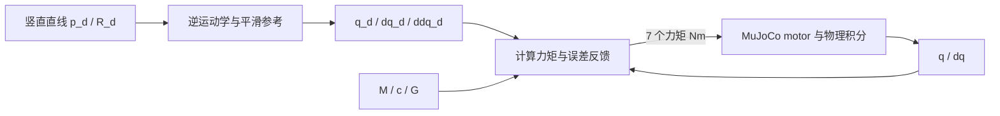

# 只发力矩，末端沿世界 Z 轴上移 10 cm

可以通过力矩接口控制末端轨迹。控制器仍需要关节角度/速度反馈，
每个周期把运动目标换算成七个关节的力矩。**力矩模式定义的是电机接收什么指令，
并不限制上层只能做重力补偿、不能控制位置。**

这是一个独立的入门例子，用计算力矩控制（computed torque control）加 PD 反馈。
无需先理解 LQR/MPC，已有 LQR/扰动实验继续保留。

## 运行

在你本地电脑的 `kaixuan` 仓库根目录中：

```bash
git pull --ff-only
cd remote_xiaogong_kaixuan/control_lab
conda activate mujoco_test

# 实时物理仿真窗口，不是给定关节角的动画回放
python -m kaixuan_control_lab.run_torque_line --viewer

# 无窗口数值实验
python -m kaixuan_control_lab.run_torque_line

# 可选：由 Pinocchio 计算轨迹和控制力矩，MuJoCo 仍是被控物理系统
python -m kaixuan_control_lab.run_torque_line --dynamics pinocchio --viewer
```

运行代码不依赖电脑的绝对路径，任何包含 `model/` 和 `control_lab/` 的仓库副本都可使用。
使用已有 `requirements-lqr.txt` 依赖；Pinocchio 选项另需 `requirements-pinocchio.txt`。
新机器安装方式见主 README。

启动后默认：初始姿态保持 1 秒 → 用 4 秒上移 10 cm → 最终姿态保持 1 秒 → 输出结果。
绿色线段是目标路径，黄色标记是当前目标点，蓝色标记是实际末端。
`--move-seconds 8` 可以把运动段改为 8 秒；它需要为 0.01 秒的整数倍。
关闭窗口或触发保护会保留已完成的数据，并报告未完成。

参数定义在 [`run_torque_line.py`](../../kaixuan_control_lab/run_torque_line.py)：

```python
TARGET_JOINTS_DEG = [-20, 20, 30, 50, -10, -20, 0]
DISPLACEMENT_WORLD_M = [0.0, 0.0, 0.10]
```

顺序为 `left_joint1` 到 `left_joint7`。TARGET 是仿真的**初始条件**，
不是从任意真机状态移动到该姿态的指令；程序不连接真实机械臂。
Z 指 world/base 的竖直向上方向，工具自身的 Z 轴可以指向别的方向。
末端位置移动时，末端的初始朝向保持不变。

当前模型计算的起终点（world，米）：

```text
起点： [0.47410405, 0.29824385, 0.52584026]
终点： [0.47410405, 0.29824385, 0.62584026]
```

## 第一步：把“向上 10 cm”变成随时间变化的目标

用正向运动学从初始关节角 q0 得到末端位置 p0、姿态 R0。
运动段时长 T=4 s，令 `s=clip((t-1)/T,0,1)`，采用五次平滑时间函数：

\[
\sigma(s)=10s^3-15s^4+6s^5,
\qquad p_d(t)=p_0+\begin{bmatrix}0\\0\\0.10\end{bmatrix}\sigma(s),
\qquad R_d(t)=R_0.
\]

X、Y 始终固定，所以目标路径是世界坐标系中的竖直直线。
这个函数在运动段起终点的速度、加速度都为零，比瞬间跳到最终目标平滑。
起点和终点之间只给出两个关节角，再按关节角线性插值，一般不会得到末端直线。

轨迹实现复用 [`trajectory.py`](../../kaixuan_control_lab/trajectory.py)。

## 第二步：求这条直线对应的关节参考轨迹

每 10 ms 对目标位姿做一次逆运动学，用上一点的关节角作为下一点的初值，得到连续 qd。
每次迭代用雅可比修正角度：

\[
\Delta q=J^T(JJ^T+\lambda I)^{-1}
\begin{bmatrix}p_d-p(q)\\\operatorname{Log}(R_dR(q)^T)\end{bmatrix}.
\]

七个关节实现六维位姿任务时存在冗余，这里采用连续的小步最小范数修正。
关节样条进一步提供 `qd(t)、dqd(t)、ddqd(t)`，并在 1 ms 网格上检查末端几何误差。
检查通过后才开始物理仿真；不可达、越界或参考速度/力矩过大都会报错。

**这些 qd 是控制器内部的参考量，没有发送给电机作为位置指令。**

## 第三步：误差决定加速度，加速度通过动力学变成力矩

当前基线没有物理摩擦和外力，动力学是：

\[
M(q)\ddot q+c(q,\dot q)+G(q)=\tau.
\]

这里 M 已包含配置中的第 7 轴附加惯量。`bias(q,dq)=c+G`，不能再重复加重力。
控制器采用：

\[
e=q_d-q,\qquad \dot e=\dot q_d-\dot q,
\]
\[
\boxed{\tau=M(q)\left[\ddot q_d+K_p e+K_d\dot e\right]+c(q,\dot q)+G(q)}.
\]

对应 `computed_torque()` 的核心就是：

```python
acceleration = ddq_ref + kp * (q_ref - q) + kd * (dq_ref - dq)
tau = dynamics.mass(q) @ acceleration + dynamics.bias(q, dq)
```

每一项的作用：

| 项 | 作用 |
| --- | --- |
| `ddq_ref` | 根据计划提前给出加速/减速需求 |
| `Kp*(q_ref-q)` | 落后或偏离目标角度时修正 |
| `Kd*(dq_ref-dq)` | 修正速度误差、抑制振荡 |
| `M(q) @ acceleration` | 把七轴加速度需求换算成耦合的关节力矩 |
| `c(q,dq)` | 补偿运动中的科氏/离心项 |
| `G(q)` | 支撑自身重量 |

本例 `Kp=144 I s⁻²`、`Kd=24 I s⁻¹`，来自 `ωn=12 rad/s、ζ=1`：
`Kp=ωn² I、Kd=2ζωn I`。它们是反馈设计参数，不是辨识出来的物理阻尼。
由于 Kp/Kd 在 M 内部，它们也不是直接以 Nm/rad 定义的普通力矩 PD 增益。

把控制公式代回理想连续动力学，得到：

\[
\ddot e+K_d\dot e+K_p e=0.
\]

这说明在模型准确、执行器能实现力矩且没有未建模外力时，误差会衰减。
实际离散周期、限幅、模型误差、摩擦和延迟会改变这个结论，需要重新验证性能。

如果只发 G(q)，在静止且模型准确时就只有重力平衡，没有沿直线走的要求。
本例在重力项之外加入了运动前馈和误差反馈，所以会加速、移动、减速、停住。

这就是 [Modern Robotics 中的计算力矩运动控制](https://modernrobotics.northwestern.edu/nu-gm-book-resource/11-4-motion-control-with-torque-or-force-inputs-part-3-of-3/) 的一种实现。

## 第四步：电机接收的始终是力矩

物理积分和反馈周期均为 1 ms。运行循环可以概括成：

```python
state = plant.state()                          # 编码器类反馈：q、dq
q_ref, dq_ref, ddq_ref = reference.sample(t)    # 只是控制器内部参考
tau = computed_torque(dynamics, state.q, state.dq, q_ref, dq_ref, ddq_ref)
plant.step(tau)                               # 只向七个 motor 写入 Nm
```

后端设置的是 `data.ctrl[:]`，`motor gear=1`。随后 `mj_step` 用力矩积分出新的 q、dq。
启动时按要求设置一次初始姿态；运动过程中没有覆盖 qpos/qvel，也没有位置执行器。
`--viewer` 显示的也是这个闭环的实时仿真。

可以把闭环看成：



## 看什么结果

运行后在 `artifacts/torque_line_<UTC时间>/` 保存：

- `tracking.png`：Z 方向位移、X/Y 侧向偏差、七轴力矩、位置跟踪误差。
- `summary.json`：目标/实际位移、最大误差、角速度、力矩峰值、饱和次数、完成状态。
- `trace.npz`：包含末状态的 q/dq、参考值、末端轨迹、请求/施加力矩和实际广义驱动力矩。
- `trace.csv`：时刻 t 的状态与用于下一物理步的力矩；最终状态在 NPZ/summary 中。

默认验收：完整结束、全过程位置与侧向误差 <1 mm、终点误差 <0.1 mm、
末端朝向误差 <0.1°、无力矩饱和；同时保留原有位置/90°/s 速度保护。
不满足则返回非零退出码，不会把停机当作完成目标。

2026-11-06 的无窗口结果：MuJoCo 模型和 Pinocchio 模型分别作为控制器，都完成约 0.100000 m 上移；
最大跟踪误差约 0.002972 mm，最大侧向偏差约 0.000833 mm，关节最高速度约 13.8106°/s。
这来自理想、无摩擦、无延迟且模型匹配的仿真，**不是实机精度承诺**。
本次 SSH 环境验证了无窗口运动、图表和可视化标记构造；桌面窗口请在本地运行。

运行针对性测试：

```bash
python -m unittest discover -s experiments/00_torque_line/tests -v
```

其中一个对照保留完全相同的运动参考，却把输出改为纯重力补偿：机器人保持原位，
终点误差为 100 mm。它用来验证轨迹没有被直接写入关节状态，运动确实来自力矩闭环。
